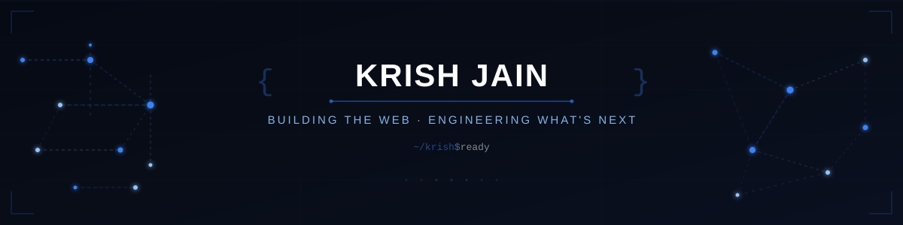

<div align="center">

<!-- ═══════════════════════════ BANNER ═══════════════════════════ -->



<br/>

<!-- ═══════════════════════ TYPING ANIMATION ═══════════════════════ -->

<a href="https://git.io/typing-svg"></a>

<br/>

<!-- ═══════════════════════ QUICK LINKS ═══════════════════════ -->

[](https://krishverse-portfolio.onrender.com)&nbsp;
[](https://www.linkedin.com/in/krish2006-jain)&nbsp;
[](mailto:krishkjai90@gmail.com)&nbsp;
[](https://github.com/krish2006-jain)

</div>

<!-- ═══════════════════════ TERMINAL INTRO ═══════════════════════ -->

```
krish@dev:~$ whoami
────────────────────────────────────────
  Name      : Krish Jain
  Role      : Full-Stack Developer
  Education : B.Tech Computer Engineering @ KJ Somaiya College of Engineering
  Status    : Building, learning, shipping.

krish@dev:~$ interests --list
────────────────────────────────────────
  ▸ Full-Stack Web Development (MERN)
  ▸ Artificial Intelligence & Machine Learning
  ▸ Cybersecurity & Networking
  ▸ Quantum Computing
  ▸ Problem Solving & DSA

krish@dev:~$ current-mission
────────────────────────────────────────
  Build software that solves real problems.
  Understand how systems work under the hood.
  Ship code, learn daily, repeat.
```

---

<!-- ═══════════════════════════ ABOUT ═══════════════════════════ -->

##  &nbsp;About Me

I'm a Computer Engineering student at **KJ Somaiya College of Engineering** who enjoys turning ideas into working software. Most of my time goes into building full-stack web apps with the MERN stack — I like the process of designing a UI, wiring up an API, and seeing it all come together.

Beyond web dev, I'm exploring **AI/ML** and thinking about how intelligent systems can make apps smarter. I'm curious about **cybersecurity** — understanding how systems can be secured (and broken). I also dabble in **quantum computing** because I find the intersection of physics and computation fascinating.

When I'm not coding, I'm usually solving problems on HackerRank, reading about new tech, or building something at a hackathon.

---

<!-- ═══════════════════════════ TECH STACK ═══════════════════════════ -->

##  &nbsp;Tech Stack

<table>
<tr>
<td valign="top" width="50%">

#### Languages


#### Frontend


</td>
<td valign="top" width="50%">

#### Backend & Databases


#### Tools & Platforms


</td>
</tr>
</table>

<details>
<summary><b>🔭 Currently Exploring</b></summary>
<br/>


</details>

---

<!-- ═══════════════════════ FEATURED PROJECTS ═══════════════════════ -->

##  &nbsp;Featured Projects

<table>
<tr>
<td width="50%">

### 📦 Stockly
**Multi-Tenant Inventory Management System**

Production-ready SaaS platform with role-based access control, Point of Sale, real-time inventory tracking, QR/barcode scanning, automated email notifications, and PDF invoice generation.

`React` `Node.js` `Express` `MongoDB` `JWT`

[](https://github.com/krish2006-jain/Inventory-Management-System)
[](https://inventory-management-system-1-ud6w.onrender.com)

</td>
<td width="50%">

### 🧠 SaathiCare
**AI-Powered Alzheimer's Care Platform**

Built for the Aftermath Hackathon — supports four user roles (patient, guardian, caretaker, Good Samaritan) with an AI Memory Companion, cognitive memory flashcards, QR-based emergency identity, live chat, and GPS sharing. **Top 10 Finalist.**

`React` `Node.js` `MongoDB` `AI/ML` `QR`

[](https://github.com/krish2006-jain/Snack)
[](https://snack-production-ca02.up.railway.app)

</td>
</tr>
<tr>
<td width="50%">

### 🎬 Netflix Clone
**Full-Stack Streaming Platform**

Full-stack Netflix clone with JWT authentication, TMDB API integration, trending content discovery, YouTube trailer playback, advanced search, watch history management, and a responsive Netflix-inspired UI.

`React` `Node.js` `Express` `MongoDB` `TMDB API`

[](https://github.com/krish2006-jain/Netflix-clone-using-mernstack)
[](https://netflix-clone-using-mernstack.onrender.com)

</td>
<td width="50%">

### 🚇 Kochi MetroMind
**Smart Induction Planning System — SIH**

Frontend development for real-time induction planning dashboards with interactive visualizations, ranked induction lists, operational alerts, and explainable decision displays. Built as part of the Smart India Hackathon problem statement.

`React` `Dashboard` `Data Viz` `REST APIs`

[](https://github.com/krish2006-jain/kasped-changes-part2)

</td>
</tr>
</table>

---

<!-- ═══════════════════════ EXPERIENCE ═══════════════════════ -->

##  &nbsp;Experience

| Role | Organization | Period | Highlights |
|:-----|:-------------|:-------|:-----------|
| **React Developer Intern** | Toyo Engineering India Pvt. Ltd. | Jun 2026 – Jul 2026 | Built responsive React components, improved UI/UX and cross-page visual consistency |
| **Web Developer & Automation Tester** | SWDC | Jan 2025 – Present | Full-stack MERN development, REST APIs, auth, Selenium automation & regression testing |
| **MERN Full Stack Developer Intern** | SWDC | Jun 2025 – Jul 2025 | 45-hour intensive internship — built full-stack apps, frontend + backend + DB integration |

---

<!-- ═══════════════════════ ACHIEVEMENTS ═══════════════════════ -->

##  &nbsp;Achievements

| Achievement | Details |
|:------------|:--------|
| 🥈 **2nd Place — TECHXTER 15.0** | National Research Paper Presentation on advancing healthcare AI using Neuro-Symbolic architectures |
| ⭐ **5★ HackerRank — Python** | Achieved 5-star rating in Python problem solving |
| 🏆 **Top 10 — Aftermath Hackathon** | SaathiCare — AI-powered Alzheimer's care platform |
| 🚀 **ACM Hackathon Participant** | Helios — space-themed productivity and habit-tracking app |
| 🏛️ **SIH Problem Statement** | Kochi MetroMind — frontend development for smart induction planning |

---

<!-- ═══════════════════════ GITHUB STATS ═══════════════════════ -->

##  &nbsp;GitHub Activity

<div align="center">

<a href="https://github.com/krish2006-jain">
  
</a>
&nbsp;&nbsp;
<a href="https://github.com/krish2006-jain">
  
</a>

<br/><br/>

<a href="https://github.com/krish2006-jain">
  
</a>

</div>

---

<!-- ═══════════════════════ CURRENT FOCUS ═══════════════════════ -->

##  &nbsp;What I'm Working On

- 🔨 **Building** full-stack web applications and shipping them to production
- 🤖 **Learning** Artificial Intelligence, Machine Learning, and Generative AI
- 🔐 **Exploring** cybersecurity fundamentals and network security
- ⚛️ **Experimenting** with quantum computing concepts and Qiskit
- 📈 **Practicing** data structures, algorithms, and competitive programming

---

<!-- ═══════════════════════ CONTACT ═══════════════════════ -->

<div align="center">


### Let's Connect

I'm open to internship opportunities, project collaborations, and technical discussions.

[](https://krishverse-portfolio.onrender.com)&nbsp;
[](https://www.linkedin.com/in/krish2006-jain)&nbsp;
[](mailto:krishkjai90@gmail.com)&nbsp;
[](https://github.com/krish2006-jain)

<br/>


<br/><br/>

```
krish@dev:~$ echo "Thanks for stopping by!"
Thanks for stopping by!
```

</div>

